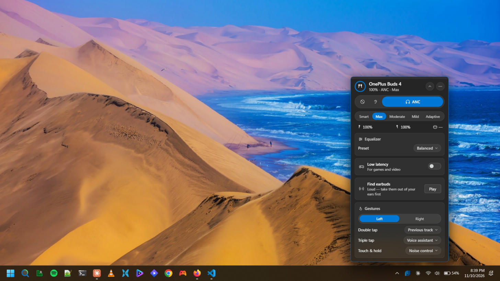
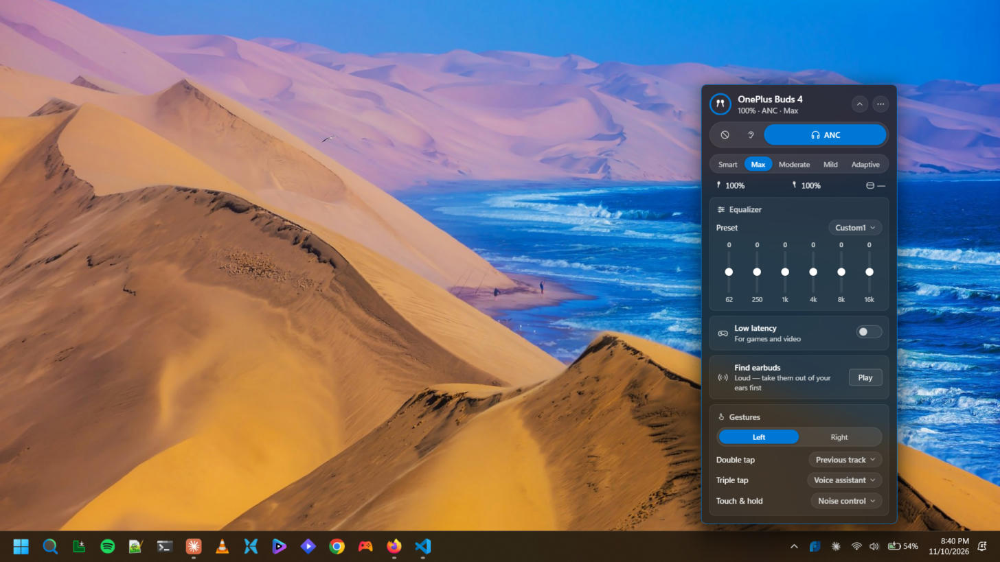
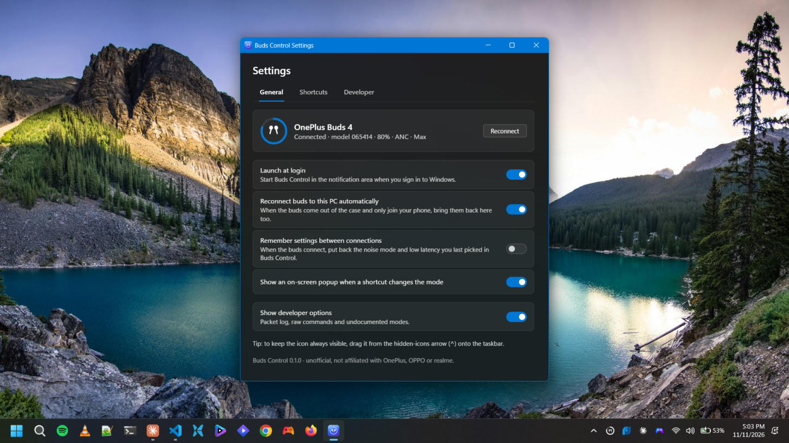
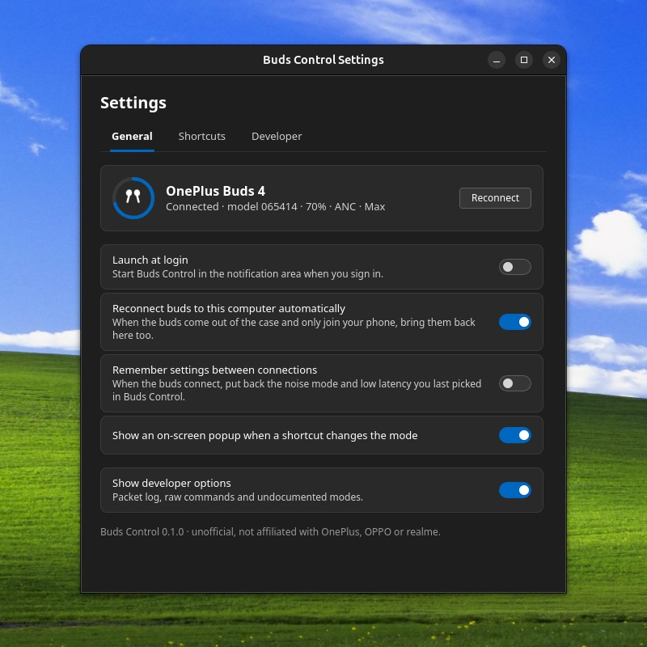

# Buds Control

**Control OnePlus, OPPO and realme earbuds from your PC's tray, without the phone app.**

Switch between noise cancellation, transparency and off in one click, pick the ANC level, check the battery and change
the equalizer. Buds Control is a cross-platform port of
[amarsakore/BudsControl](https://github.com/amarsakore/BudsControl) (a macOS app), built with Rust, Tauri 2 and Svelte.

<p align="center">
  
</p>

| Platform | Status |
|---|---|
| **Windows 10 / 11** (x64) | Tested on real hardware (OnePlus Buds 4) |
| **Linux** (x64) | Tested on real hardware (Ubuntu 24.04, GNOME on X11 and Wayland, OnePlus Buds 4), including the `.deb` and the AppImage. Other distributions and desktops are untested. See the [Linux notes](docs/LINUX.md) for the Wayland limitations and known issues; reports welcome |
| **macOS 11+** (Apple silicon, Intel) | Tested once on real hardware (macOS 27, Apple silicon, OnePlus Buds 3): connection, modes, EQ, gestures and find earbuds work. The menu bar flyout, Settings and the .dmg install were checked too, and Intel Macs are **untested**; reports welcome. The [original app](https://github.com/amarsakore/BudsControl) is the long-tested choice on a Mac |

## At a glance

| | Windows | Linux | macOS |
|---|---|---|---|
| Download | 1.8 MiB installer, 2.5 MiB portable zip | 4.0 MiB `.deb`, 88 MiB AppImage | 3.2 MiB `.dmg` (Apple silicon) |
| Memory while idle in the tray | 182 MB private (app and web view) | 207 MB proportional (app and web view) | not measured |
| CPU while idle | 0.6 % of one core | under 1 s of CPU per minute | not measured |
| Connecting to the buds | 0.13-0.17 s | 0.24-0.3 s | 0.12-0.29 s |

Most of the memory is the system web view that draws the window; the Rust program itself is 32-64 MB. How these were
measured, and more numbers: [docs/PERFORMANCE.md](docs/PERFORMANCE.md).

## Contents

- [Features](#features)
- [Download and install](#download-and-install)
- [Using it](#using-it)
- [Command line (`budsctl`)](#command-line-budsctl)
- [Troubleshooting](#troubleshooting)
- [How it works](#how-it-works)
- [Building from source](#building-from-source)
- [Contributing](#contributing)
- [Credits](#credits) · [Disclaimer](#disclaimer) · [License](#license)

## Features

- One-click **noise control** (ANC, Transparency, Off) and the five **ANC levels** (Smart, Max, Moderate, Mild,
  Adaptive) where the model has them.
- **Battery** for the left bud, right bud and case, also shown as a ring on the **tray icon** (with a charging bolt),
  following the light/dark taskbar.
- **Equalizer** presets and custom EQ, **low latency** mode, **find my earbuds** and **touch gestures**.
- **Global shortcuts** (cycle, ANC, Transparency, Off) with a small on-screen popup.
- **Automatic reconnect** when the buds joined only your phone, optional **remembered settings**, **launch at
  login**.
- **`budsctl`**, a command-line tool that controls the buds directly or through the running app.
- Developer tools: packet log, raw commands, service discovery.

105 models of the OnePlus Buds, OPPO Enco and realme Buds families are known; the controls shown follow what the
model supports. Nothing is sent to the internet.

<p align="center">
  
  
</p>

The same app on Ubuntu 24.04 with GNOME:

<p align="center">
  
  
</p>

## Download and install

Get the latest build from the [**Releases**](../../releases/latest) page. Pair your earbuds with the computer in the
system's Bluetooth settings **before** starting Buds Control.

### Windows

| File | What it is |
|---|---|
| `BudsControl-<version>-windows-x64-setup.exe` | Installer. Installs for the current user (no administrator rights), adds a Start menu entry and an uninstaller. |
| `BudsControl-<version>-windows-x64-portable.zip` | Portable. Unzip anywhere and run `BudsControl.exe`; `budsctl.exe` sits next to it. |

- Needs the Microsoft Edge **WebView2** runtime (part of Windows 11 and up-to-date Windows 10; the installer
  downloads it if missing).
- The builds are **not code-signed**, so SmartScreen shows "Windows protected your PC": choose **More info > Run
  anyway**.
- Windows hides new tray icons behind the **^** arrow next to the clock. To keep Buds Control visible, drag its icon
  onto the taskbar, or turn it on under *Settings > Personalization > Taskbar > Other system tray icons*.

### Linux (tested on Ubuntu 24.04; see [docs/LINUX.md](docs/LINUX.md))

| File | What it is |
|---|---|
| `BudsControl-<version>-linux-x64.AppImage` | Runs on most distributions: `chmod +x` it and start it. |
| `BudsControl-<version>-linux-x64.deb` | Debian / Ubuntu: `sudo apt install ./BudsControl-*.deb` |

- Needs BlueZ (`bluetoothd` running) and a desktop with a system tray (KDE, XFCE, Cinnamon, or GNOME with the
  AppIndicator extension).
- Buds Control talks to BlueZ over D-Bus, so your user must be allowed to use Bluetooth (on some distributions that
  means being in the `bluetooth` group).

### macOS (tested once on hardware, see the table above)

- Download `BudsControl-<version>-macos-arm64.dmg` (Apple silicon) or `BudsControl-<version>-macos-x64.dmg` (Intel)
  and drag the app to *Applications*.
- The app is signed ad hoc, not notarised, so macOS says it could not verify it. Click **Done** (not Move to Bin), open
  **System Settings > Privacy & Security**, scroll down and click **Open Anyway** next to Buds Control (on older macOS
  versions, right-click the app and choose **Open**). Or run
  `xattr -dr com.apple.quarantine "/Applications/Buds Control.app"` once.
- macOS asks once for permission to use Bluetooth; allow it.

## Using it

| | Windows | Linux | macOS |
|---|---|---|---|
| Open the flyout | click the tray icon | tray menu > **Open Buds Control** | click the menu-bar icon |
| Menu (modes, Settings, Reconnect, Quit) | right-click the tray icon | click the tray icon | right-click or Control-click |
| Shortcut popup | on-screen popup | desktop notification | on-screen popup |

Starting the app a second time just opens the flyout. Shortcuts are set under **Settings > Shortcuts**.

On Linux, global shortcuts work on X11 only. On Wayland, bind keys to `budsctl cycle` (or `anc`, `transparency`,
`off`) in your desktop's keyboard settings instead. Also on Wayland, the app runs through Xwayland so it can place the
flyout, which opens at the right end of the panel instead of under the tray icon. The earbuds only accept a noise-mode
change while they are in your ears. Details and other known issues: [docs/LINUX.md](docs/LINUX.md).

## Command line (`budsctl`)

`budsctl` ships with the app (next to `BudsControl.exe`, or inside the app bundle).

```text
budsctl status                 show the buds' state
budsctl anc | transparency | off | cycle
budsctl max                    ANC level (smart, max, moderate, mild, adaptive)
budsctl eq=1   lowlatency=on   find=on   gesture=left,doubleTap,next
budsctl devices | sdp | audio  diagnostics (paired devices, services, audio endpoints)
```

The buds accept only one control connection, so while the tray app is running `budsctl` hands the command to it and
prints the same output; `--direct` forces a direct connection. `budsctl --help` lists everything, and `--fake` tries
the commands on simulated buds.

## Troubleshooting

- **"Not connected"**: make sure the buds are out of the case and connected to *this* computer (not only to your
  phone). Use **Reconnect** in the menu, or turn on *Reconnect buds to this PC automatically* in Settings.
- **"Connected" but no battery or controls**: the buds accept only one control connection. If your phone's earbud app
  or another program is holding it, Buds Control can see the buds but gets no answers. Close the other app or turn off
  the phone's Bluetooth; the app retries by itself (**Reconnect** skips the wait).
- **A mode change is ignored**: the earbuds only accept a noise-mode change while they are in your ears. Some models
  also lack certain modes or levels; the flyout shows only what the model reports.
- **Shortcut shows "Used by another app"**: another program has registered that key combination; pick another.
- **Collecting details for a bug report**: run `budsctl status` and `budsctl devices`, and attach the log file:

| OS | Log file |
|---|---|
| Windows | `%LOCALAPPDATA%\BudsControl\BudsControl.log` |
| Linux | `~/.local/share/BudsControl/BudsControl.log` |
| macOS | `~/Library/Logs/BudsControl.log` |

The log contains your Bluetooth device names and addresses; remove them before posting if you prefer.

## How it works

The earbuds speak the HeyMelody protocol over a classic Bluetooth RFCOMM channel (service `079A`, channel 15 on the
Buds 4). Buds Control opens that channel (Winsock on Windows, BlueZ on Linux, IOBluetooth on macOS), asks for the
state and sends framed commands. When the buds are connected only to your phone, a reconnect request to the system's
Bluetooth audio driver brings them to the computer. Nothing is changed on the buds besides what you ask for.

Details: [docs/PROTOCOL.md](docs/PROTOCOL.md).

## Building from source

Requirements: Rust 1.90 or newer (the MSVC toolchain and the Visual Studio C++ Build Tools on Windows) and Node 20.19
or newer, or 22.12 or newer. On Linux also: `libwebkit2gtk-4.1-dev libayatana-appindicator3-dev librsvg2-dev
libdbus-1-dev pkg-config patchelf libssl-dev libxdo-dev`.

```bash
npm install
npm run tauri dev          # run the app (set BUDS_FAKE=1 to use simulated buds)
```

Checks:

```bash
npm run check              # svelte-check + tsc
npm test                   # frontend unit tests
cargo fmt --all --check
cargo clippy --workspace --all-targets -- -D warnings
cargo test --workspace
```

Release packages go to `release/`:

| OS | Command | Output |
|---|---|---|
| Windows | `./scripts/package-windows.ps1` | installer + portable zip |
| Linux | `./scripts/package-linux.sh` | AppImage + .deb |
| macOS | `./scripts/package-macos.sh` | .dmg for the Mac's architecture |

Pushing a `v*` tag builds all of them on GitHub Actions and attaches them to a release; see
[docs/RELEASING.md](docs/RELEASING.md).

### Project layout

| Path | What it is |
|---|---|
| `crates/buds-core` | Protocol, parsers, device catalog, controller, settings, IPC (no OS code) |
| `crates/buds-bt` | Bluetooth backends for Windows, Linux and macOS |
| `crates/budsctl` | Command-line tool |
| `crates/buds-art` | Tray icon drawing |
| `crates/icongen` | App icon generator |
| `src-tauri` | The Tauri app: tray, windows, shortcuts, popup |
| `src` | Svelte frontend (flyout, settings, popup) |
| `docs` | Protocol notes, hardware test log, Linux notes, performance figures and the release guide |

### Without the buds

- `BUDS_FAKE=1 npm run tauri dev` runs the app against simulated buds (`BUDS_FAKE_SWEEP=1` also sweeps the battery
  level).
- `npm run dev`, then open `http://localhost:1420/flyout.html?scenario=<name>&more=1` in a browser to review the UI.
  Scenarios: `connected`, `anc`, `customeq`, `disconnected`, `connecting`, `lowbattery`, `charging`, `finding`,
  `longeq`, `minimal`, `noanc`.
- `BUDS_TASKBAR_THEME=light|dark` forces the tray icon colour.

Regenerating assets: the app icon with `cargo run -p icongen -- app-icon.png` then `npx tauri icon app-icon.png`; the
tray icon contact sheet with `cargo run -p buds-art --example contact_sheet -- docs/screenshots/tray-icons.png`.

## Contributing

Bug reports, hardware reports (especially from **Linux** and **macOS**, and from earbud models other than the Buds 4)
and pull requests are welcome. See [CONTRIBUTING.md](CONTRIBUTING.md).

## Credits

- [amarsakore](https://github.com/amarsakore) and the contributors of the original
  [BudsControl](https://github.com/amarsakore/BudsControl).
- Protocol references: the Noctalia `oppo-pods` plugin (MIT), Gadgetbridge's OPPO support, and RawS-Music's HeyMelody
  port (Apache-2.0). See [THIRD_PARTY_NOTICES.md](THIRD_PARTY_NOTICES.md).

## Disclaimer

Unofficial project, not affiliated with or endorsed by OnePlus, OPPO, realme, Microsoft or Apple. All product names
are trademarks of their owners. Use at your own risk.

## License

[MIT](LICENSE)
