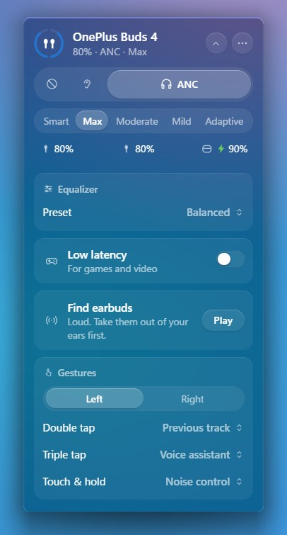
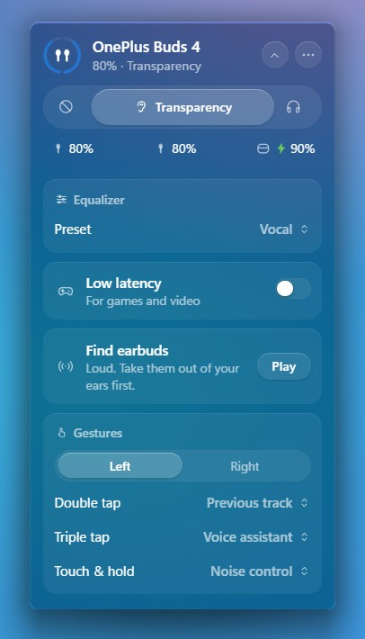
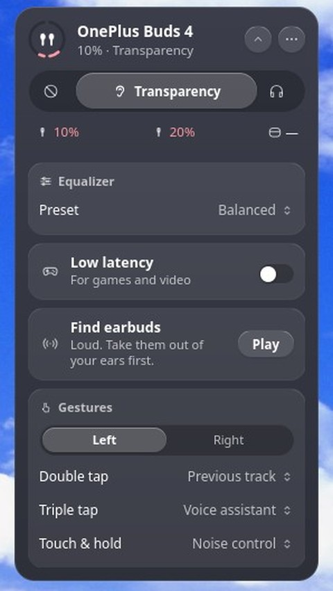
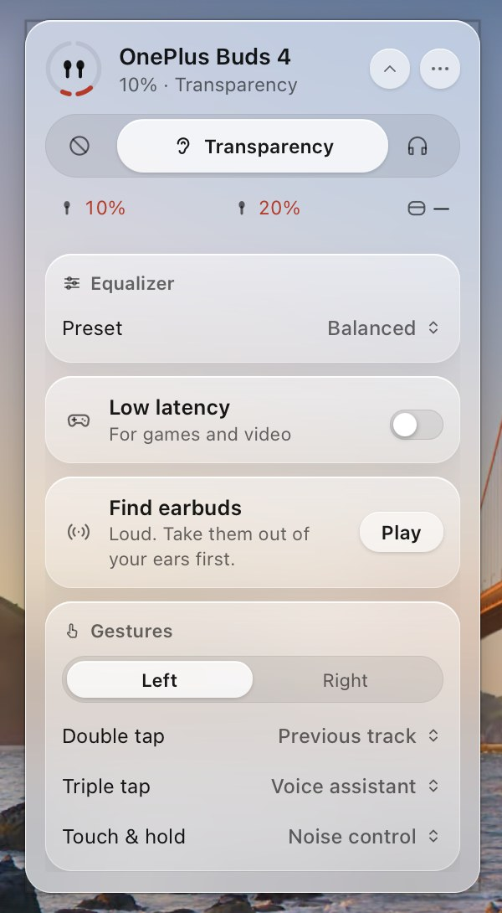

<p align="center">
  
</p>

<h1 align="center">Buds Control</h1>

<p align="center">
  <b>Control OnePlus, OPPO and realme earbuds from the tray, without the phone app.</b><br>
  Windows · Linux · macOS
</p>

<p align="center">
  <a href="../../releases/latest"></a>
  <a href="../../actions/workflows/ci.yml"></a>
  <a href="LICENSE"></a>
</p>

<p align="center">
  
  
  
  
</p>

One click to switch noise cancellation, transparency and off, pick the ANC level, check the battery and change the
equalizer. A cross-platform port of [amarsakore/BudsControl](https://github.com/amarsakore/BudsControl) (a macOS app),
built with Rust, Tauri 2 and Svelte. Small, offline, and nothing is sent to the internet.

## Features

- **Noise control** (ANC, Transparency, Off) and the five ANC levels on models that have them.
- **Battery** for each bud and the case, also on the tray icon as a ring split in two (left half for the left bud, right
  half for the right).
- **Equalizer** presets and custom EQ, **low latency**, **find my earbuds**, **touch gestures**.
- **Global shortcuts**, **automatic reconnect**, remembered settings, launch at login.
- **`budsctl`**, a command-line tool. Developer tools: packet log, raw commands, service discovery.

105 models of the OnePlus Buds, OPPO Enco and realme Buds families are known; the controls follow what the model
supports.

| Platform | Status | Tested with |
|---|---|---|
| **Windows 10 / 11** (x64) | Tested | OnePlus Buds 4 |
| **Linux** (x64) | Tested on Ubuntu 24.04; other distributions and desktops are **untested** | Buds 4, GNOME on X11 and Wayland |
| **macOS 11+** (Apple silicon, Intel) | Tested on one Apple silicon Mac; Intel is **untested** | Buds 3 and Buds 4, macOS 27 |

Bug and hardware reports are welcome ([CONTRIBUTING.md](CONTRIBUTING.md)). Sizes, memory and speed:
[docs/PERFORMANCE.md](docs/PERFORMANCE.md).

## Download and install

Get the latest build from [**Releases**](../../releases/latest). Pair the earbuds with the computer in the system's
Bluetooth settings **before** starting Buds Control.

- **Windows**: run `BudsControl-<version>-windows-x64-setup.exe` (per-user, no admin rights), or unzip the portable zip.
  Needs the WebView2 runtime (the installer fetches it if missing). The builds are not code-signed, so choose **More
  info > Run anyway** in SmartScreen. New tray icons hide behind the **^** arrow; drag the icon onto the taskbar to keep
  it visible.
- **Linux**: `sudo apt install ./BudsControl-*.deb`, or `chmod +x` the `.AppImage` and start it. Needs BlueZ and a
  system tray (KDE, XFCE, Cinnamon, or GNOME with the AppIndicator extension). Details: [docs/LINUX.md](docs/LINUX.md).
- **macOS**: open the `.dmg` for your Mac (`arm64` or `x64`) and drag the app to *Applications*. It is signed ad hoc,
  not notarised: click **Done**, then **System Settings > Privacy & Security > Open Anyway**. Allow the Bluetooth
  prompt once.

## Using it

| | Windows | Linux | macOS |
|---|---|---|---|
| Open the flyout | click the tray icon | tray menu > **Open Buds Control** | click the menu-bar icon |
| Menu (modes, Settings, Reconnect, Quit) | right-click the tray icon | click the tray icon | right-click or Control-click |

Starting the app a second time just opens the flyout. Shortcuts are set under **Settings > Shortcuts**. The earbuds
only accept a noise-mode change while they are in your ears. On Linux, global shortcuts work on X11 only; on Wayland,
bind keys to `budsctl cycle` (or `anc`, `transparency`, `off`) instead.

### Command line

```text
budsctl status                 show the buds' state
budsctl anc | transparency | off | cycle
budsctl max                    ANC level (smart, max, moderate, mild, adaptive)
budsctl eq=1   lowlatency=on   find=on   gesture=left,doubleTap,next
budsctl devices | sdp | audio  diagnostics
```

The buds accept one control connection, so while the tray app runs `budsctl` hands the command to it (`--direct`
forces a direct connection). `budsctl --help` lists everything; `--fake` tries it on simulated buds.

## Troubleshooting

- **"Not connected"**: take the buds out of the case and connect them to *this* computer (not only the phone), then use
  **Reconnect**.
- **"Connected" but no battery or controls**: the phone's earbud app or another program holds the one control
  connection. Close it or turn off the phone's Bluetooth.
- **A mode change is ignored**: the earbuds accept it only while in your ears; some models lack some modes.
- **Bug reports**: attach `budsctl status`, `budsctl devices` and the log (`%LOCALAPPDATA%\BudsControl\BudsControl.log`
  on Windows, `~/.local/share/BudsControl/BudsControl.log` on Linux, `~/Library/Logs/BudsControl.log` on macOS). It
  contains your Bluetooth device names and addresses.

## How it works

The earbuds speak the HeyMelody protocol over a classic Bluetooth RFCOMM channel. Buds Control opens it (Winsock,
BlueZ or IOBluetooth), asks for the state and sends framed commands; nothing else on the buds is changed. Details:
[docs/PROTOCOL.md](docs/PROTOCOL.md).

## Building from source

Needs Rust 1.90+ and Node 20.19+ (or 22.12+); on Linux also `libwebkit2gtk-4.1-dev libayatana-appindicator3-dev
librsvg2-dev libdbus-1-dev pkg-config patchelf libssl-dev libxdo-dev`.

```bash
npm install
npm run tauri dev          # BUDS_FAKE=1 uses simulated buds
```

Packages: `./scripts/package-windows.ps1`, `./scripts/package-linux.sh`, `./scripts/package-macos.sh` (output in
`release/`). Checks, project layout and releasing: [CONTRIBUTING.md](CONTRIBUTING.md),
[docs/RELEASING.md](docs/RELEASING.md).

## Credits, disclaimer, license

Thanks to [amarsakore](https://github.com/amarsakore) and the original
[BudsControl](https://github.com/amarsakore/BudsControl) contributors. Protocol references: the Noctalia `oppo-pods`
plugin (MIT), Gadgetbridge's OPPO support and RawS-Music's HeyMelody port (Apache-2.0); see
[THIRD_PARTY_NOTICES.md](THIRD_PARTY_NOTICES.md). Unofficial project, not affiliated with OnePlus, OPPO, realme,
Microsoft or Apple; product names are trademarks of their owners. Use at your own risk. Security issues:
[SECURITY.md](SECURITY.md). [MIT](LICENSE).
