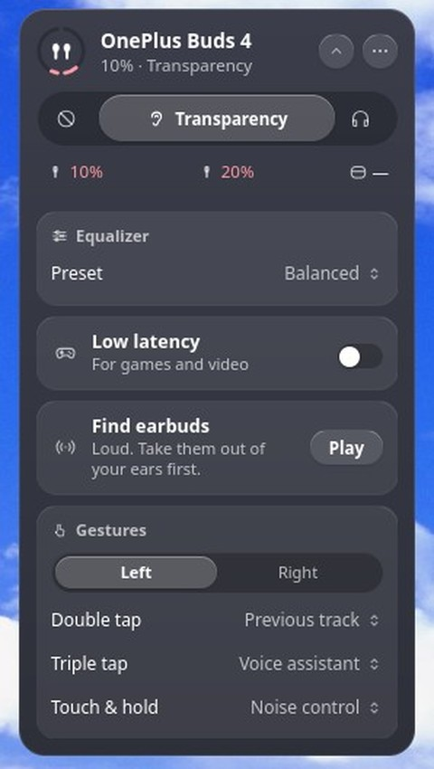
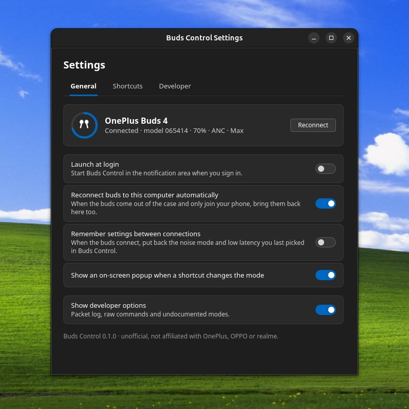

# Linux notes

What works, what doesn't, and what to know when running Buds Control on Linux. First run on real hardware: **2026-11-11**,
Ubuntu 24.04.5 LTS (GNOME 46, Intel laptop), OnePlus Buds 4, X11 and Wayland sessions. Test results are in
[TESTING.md](TESTING.md) (Gate 11).

  
  

## What was tested

| Setup | Result |
|---|---|
| Ubuntu 24.04, GNOME on **X11**, Dash to Panel (panel at the bottom) | Works. |
| Ubuntu 24.04, GNOME on **X11**, stock top bar | Works. |
| Ubuntu 24.04, GNOME on **X11**, stock top bar + Ubuntu Dock fixed on the left | Works. |
| Ubuntu 24.04, GNOME on **Wayland** | Works with the limitations below. The tray menu, Settings window and shortcut hint were not looked at on Wayland. |
| Other distributions, KDE, XFCE, Cinnamon, other tray hosts | **Untested** (no hardware); reports welcome. |

Works on all tested setups: connecting over BlueZ (HeyMelody service 079A, RFCOMM channel 15), `budsctl devices`, `sdp`
and `status`, noise modes and ANC levels, EQ presets, low latency, gestures, find earbuds, shortcuts (X11), the shortcut
notification, the tray menu, reconnect after the buds go in the case and come out again, and the "Reconnect" menu item.

## Wayland limitations

These come from how Wayland works, not from the app. Wayland deliberately stops applications from placing their own
windows and from grabbing keys globally.

1. **Global shortcuts do not work.** Wayland has no way for an app to receive a key press while another window has
   focus. The Shortcuts tab shows a hint instead. Bind keys in your desktop's keyboard settings to the command-line tool:
   `budsctl cycle`, `budsctl anc`, `budsctl transparency`, `budsctl off`. (Tested: a recorded Ctrl+Alt+O did not
   switch the mode on Wayland. That test used a synthetic key press, so treat it as strong but not conclusive.)
2. **The flyout cannot be placed by the app.** Left alone, GNOME puts it in the top-left corner. To avoid that, the app
   starts through **Xwayland** on Wayland sessions (it sets `GDK_BACKEND=x11`), where windows can be positioned. This
   happens only when `GDK_BACKEND` is not set and the X display socket exists; otherwise the app stays on native
   Wayland (and the flyout lands wherever the compositor puts it).
3. **The flyout does not sit under the tray icon.** Linux tray icons give the app no position and no click events, and
   on Wayland the pointer position is unknown too. The flyout therefore opens at the **right end of the panel**, next to
   the panel edge, which is where the tray is on GNOME and KDE. It is close to the icon but not centred on it.
4. **Xwayland can look slightly blurry** on displays with fractional scaling (125%, 150%). Set `GDK_BACKEND=wayland` to
   run natively instead; you then get a sharp window in a compositor-chosen position.
5. **Not verified on Wayland:** clicking through the tray menu, the Settings window, the "use `budsctl`" hint text, the
   flyout closing when you click elsewhere (focus handling differs between compositors), and the shortcut notification.
   The notification uses the standard desktop-notification D-Bus interface, so it should behave as on X11.

Starting the app a second time opens the flyout on every session type, which makes a handy shortcut target:
`BudsControl` (or the AppImage) bound to a key.

## Known issues (all Linux sessions)

- **Mode changes need the buds in your ears.** With the buds out (or in the case) they answer a noise-mode change with
  status `0E`. The log shows `mode change rejected: 0E`, but the flyout just snaps back to the previous mode without
  telling you why. EQ, low latency, gestures and find earbuds work with the buds out. *Planned:* show a message.
- **Settings opens without focus on GNOME**, so GNOME shows a "Buds Control Settings is ready" notification and you have
  to click the window.
- **The flyout is a resizable window on Linux.** A non-resizable GTK window never shrinks below the largest size it has
  had, which broke collapsing the panel. It has no frame, so you cannot resize it with the mouse, but a tiling helper
  (for example Ubuntu's Tiling Assistant) may snap it.
- **GNOME needs the AppIndicator extension** for any tray icon. Ubuntu ships it enabled; stock GNOME does not.
- **The buds allow one control connection.** While Buds Control is running, `budsctl` asks the running app to do the
  work. `budsctl --direct` only works when the app is closed.
- **After the buds drop** (case, out of range) the app asks BlueZ to reconnect and then opens the control channel
  about 3 seconds after the audio link is back. Expect around 15 seconds in total.
- **"Launch at login"** writes `~/.config/autostart/Buds Control.desktop`. If the app moves, the entry points at the old path.

## Building from source on Linux

- Install the system packages used by CI: `libwebkit2gtk-4.1-dev libayatana-appindicator3-dev librsvg2-dev libdbus-1-dev
  pkg-config libssl-dev libxdo-dev`.
- **Build the app with `npx tauri build --no-bundle`** (or `npm run tauri build`), not a plain `cargo build --release`.
  A plain Cargo build leaves out the embedded web UI, and every window shows "Could not connect to localhost".
- On a fresh clone, `npm ci` can leave Rolldown without its native binding, because the lockfile was generated on
  Windows (npm bug 4828), and `npm run build` fails with "Cannot find native binding". Workaround:
  `npm i --no-save @rolldown/binding-linux-x64-gnu@<installed rolldown version>`. Regenerating the lockfile on Linux
  would fix it for everyone.

## Things worth checking if you test on another setup

`budsctl devices`, `budsctl sdp` and `budsctl status` first (with the app closed). If the connection fails, send the log
(`~/.local/share/BudsControl/BudsControl.log`) and the output of `budsctl sdp`, plus your distribution, desktop and
whether the session is X11 or Wayland (`echo $XDG_SESSION_TYPE`). Hardware reports are welcome; see
[CONTRIBUTING.md](../CONTRIBUTING.md).
